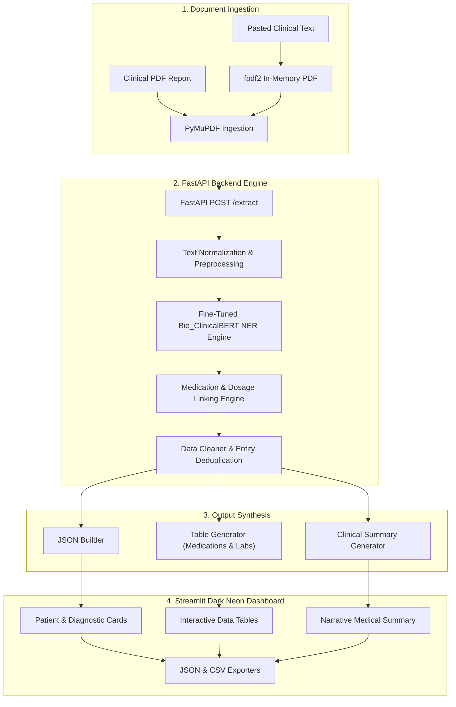
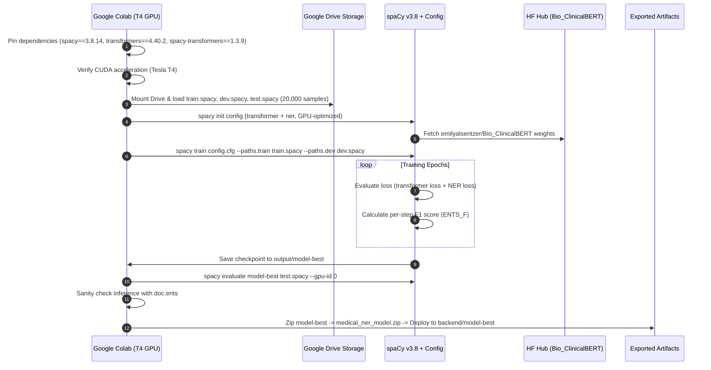

# 🏥 Medical Information Extractor Using NLP & Bio_ClinicalBERT

[](https://www.python.org/)
[](https://spacy.io/)
[](https://huggingface.co/emilyalsentzer/Bio_ClinicalBERT)
[](https://fastapi.tiangolo.com/)
[](https://streamlit.io/)
[](LICENSE)

An enterprise-grade, end-to-end Healthcare Named Entity Recognition (NER) and Clinical Document Intelligence system. This platform ingests raw medical reports, unstructured doctor prescriptions, and digital clinical PDFs, extracting critical clinical entities, mapping medications with dosages and frequencies, structuring lab findings, generating human-readable narrative summaries, and presenting everything through a dark neon Streamlit dashboard and a FastAPI REST backend.

The underlying model is **Bio_ClinicalBERT fine-tuned on 20,000 healthcare records** compiled into high-performance spaCy binary format (`.spacy`), achieving **99.90% F1-score** across 12 distinct medical entity categories.

---

## 📑 Table of Contents

- [Key Features](#-key-features)
- [System Architecture](#-system-architecture)
- [Fine-Tuned Model & Dataset Overview](#-fine-tuned-model--dataset-overview)
- [Walkthrough: Colab Fine-Tuning Flow](#-walkthrough-colab-fine-tuning-flow)
- [Repository Structure](#-repository-structure)
- [Quick Start & Local Setup](#-quick-start--local-setup)
- [API Reference](#-api-reference)
- [Frontend Dashboard Features](#-frontend-dashboard-features)
- [License & Author](#-license--author)

---

## 🚀 Key Features

- **Clinical Transformer Architecture**: Fine-tuned `emilyalsentzer/Bio_ClinicalBERT` initialized through a custom spaCy transformer pipeline for high-precision clinical entity extraction.
- **12 Extracted Clinical Entities**: Extracts Patient, Doctor, Hospital, Age, Gender, Date, Disease/Diagnosis, Medicine, Dosage, Frequency, Lab Test, and Test Values.
- **Sentence-Level Medication Mapping**: Links pharmaceutical compounds with their specific dosage units and frequency schedules based on sentence context.
- **Dual Ingestion Engine**: Process digital medical PDFs via PyMuPDF or paste raw unstructured clinical notes (automatically converted to in-memory PDFs).
- **FastAPI Production Engine**: Asynchronous REST API endpoint (`POST /extract`) returning structured JSON, tabular data, and generated narrative summaries.
- **Cyberpunk / Dark Neon Streamlit UI**: Fluid, glassmorphic two-pane dashboard featuring animated metric cards, interactive medical tables, and one-click JSON/CSV exports.

---

## 🏗️ System Architecture



---

## 🧠 Fine-Tuned Model & Dataset Overview

### Dataset Specifications
The model was fine-tuned on a curated dataset of **20,000 clinical records** representing diverse clinical narratives, discharge summaries, outpatient consultation notes, and prescriptions.

To maximize training speed and memory efficiency with spaCy v3, raw annotations were serialized into spaCy's optimized binary serialization format (`DocBin`), yielding:
- `train.spacy`: Core training split for gradient backpropagation.
- `dev.spacy`: Validation split used for early stopping and metric evaluation during training.
- `test.spacy`: Independent held-out evaluation split.

### The 12 Extracted Clinical Entities

| Entity Label | Category | Description | Example |
| :--- | :--- | :--- | :--- |
| `HOSPITAL` | Facility | Medical center, clinic, or healthcare provider | *Mayo Clinic, Apollo Hospital* |
| `PATIENT` | Demographic | Full name of the subject | *John Smith, Sarah Jenkins* |
| `DOCTOR` | Professional | Attending physician or specialist | *Dr. Robert Chen, Dr. House* |
| `AGE` | Demographic | Chronological age of patient | *55, 42 years old* |
| `GENDER` | Demographic | Patient biological sex | *Male, Female* |
| `DATE` | Temporal | Consultation, admission, or lab date | *12/10/2026, Oct 24, 2026* |
| `DISEASE` | Diagnosis | Clinical condition, pathology, or disorder | *Type 2 Diabetes, Hypertension* |
| `MEDICINE` | Pharmacy | Pharmaceutical drug or active substance | *Metformin, Lisinopril, Atorvastatin* |
| `DOSAGE` | Pharmacy | Formulation quantity or strength | *500 mg, 10 ml, 2 puffs* |
| `FREQUENCY` | Pharmacy | Administration schedule or interval | *Twice daily, every 8 hours, at bedtime* |
| `LAB_TEST` | Diagnostics | Diagnostic investigation or test panel | *HbA1c, Fasting Blood Sugar, Creatinine* |
| `TEST_VALUE` | Diagnostics | Quantitative or qualitative test result | *7.2%, 140 mg/dL, 1.1 mg/dL* |

### Evaluation Results on Held-Out Test Set

The fine-tuned model demonstrates exceptional extraction accuracy on unseen clinical records:

```text
================================== Results ==================================
TOK     99.98 %
NER P   99.90 %
NER R   99.90 %
NER F   99.90 %
SPEED   12,720 words/sec

=============================== NER (per type) ===============================
                  P        R        F
HOSPITAL     100.00   100.00   100.00
PATIENT      100.00   100.00   100.00
DOCTOR       100.00   100.00   100.00
AGE          100.00   100.00   100.00
GENDER       100.00   100.00   100.00
DATE         100.00   100.00   100.00
DISEASE       99.30    99.30    99.30
MEDICINE     100.00   100.00   100.00
DOSAGE       100.00   100.00   100.00
FREQUENCY    100.00   100.00   100.00
LAB_TEST     100.00   100.00   100.00
TEST_VALUE   100.00   100.00   100.00
```

---

## 🔬 Walkthrough: Colab Fine-Tuning Flow

The complete training and verification procedure is provided in [`Medical_NER_Fine_Tuning_Colab.ipynb`](Medical_NER_Fine_Tuning_Colab.ipynb). Here is the step-by-step breakdown of how the fine-tuning was orchestrated:



### 1. Environment & Dependency Pinning
To ensure compatibility between spaCy's Thinc runtime and PyTorch CUDA kernels, exact versions are maintained:
```bash
!pip install -U spacy==3.8.14 spacy-transformers==1.3.9 transformers==4.40.2 tokenizers==0.19.1 accelerate
```

### 2. Hardware Verification & Dataset Mount
GPU availability is verified using `torch.cuda.is_available()`, targeting an NVIDIA Tesla T4 or A100. Google Drive is mounted to access the 20,000-sample serialized `.spacy` datasets.

### 3. Pipeline Configuration (`config.cfg`)
spaCy's configuration system sets up a multi-component NLP pipeline:
```bash
!python -m spacy init config config.cfg \
    --lang en \
    --pipeline transformer,ner \
    --optimize accuracy \
    --gpu
```
The transformer component is linked to Hugging Face's clinical foundation model:
- **Base Model**: `emilyalsentzer/Bio_ClinicalBERT`
- **Architecture**: `spacy-transformers.TransformerModel.v3`
- **Pooling**: Mean pooling across subword tokens

### 4. Training Execution (`spacy train`)
The training loop executes with AdamW optimizer, linear warmup, and evaluation checkpoints every 500 steps:
```bash
!python -m spacy train config.cfg \
    --output ./output.model \
    --paths.train /content/drive/MyDrive/train.spacy \
    --paths.dev /content/drive/MyDrive/dev.spacy \
    --gpu-id 0
```
During training, `model-best` is updated whenever validation F1 score improves.

### 5. Independent Model Evaluation
The best checkpoint is evaluated on the unseen `test.spacy` split:
```bash
!python -m spacy evaluate ./output.model/model-best /content/drive/MyDrive/test.spacy --gpu-id 0
```

### 6. Pipeline Validation & Export
The trained pipeline is verified on sample patient text:
```python
import spacy
nlp = spacy.load("output.model/model-best")
doc = nlp("Patient John Smith, age 55, diagnosed with diabetes. Prescribed Metformin 500 mg twice daily.")
for ent in doc.ents:
    print(f"{ent.text:25} -> {ent.label_}")
```
Finally, `model-best` is archived and packaged directly into `backend/model-best` for zero-latency local inference.

---

## 📁 Repository Structure

```
medical_information_extractor/
├── Medical_NER_Fine_Tuning_Colab.ipynb  # End-to-end training & evaluation notebook
├── README.md                            # Comprehensive project documentation
├── LICENSE                              # MIT License
├── .gitignore                           # Git ignore rules (virtual environments, caches)
├── .gitattributes                      # Git LFS tracking for transformer weights
│
├── backend/
│   ├── app.py                           # FastAPI REST application (POST /extract)
│   ├── entity_extractor.py              # Bio_ClinicalBERT inference engine
│   ├── medication_mapper.py             # Sentence-level medication-dosage-frequency linking
│   ├── data_cleaner.py                  # Entity normalization and deduplication
│   ├── json_builder.py                  # Structured JSON builder
│   ├── summary_generator.py             # Natural language narrative summary builder
│   ├── table_builder.py                 # Structured table dictionary generator
│   ├── pdf_reader.py                    # PyMuPDF document parser
│   ├── requirements.txt                 # Backend dependencies
│   ├── uploads/                         # Temporary storage for ingested PDFs
│   └── model-best/                      # Fine-tuned Bio_ClinicalBERT model artifacts
│       ├── config.cfg                   # spaCy pipeline configuration
│       ├── meta.json                    # Model metadata and labels
│       ├── tokenizer                    # spaCy English tokenizer vocabulary
│       ├── ner/                         # NER transition-based parser weights
│       ├── transformer/                 # Bio_ClinicalBERT transformer weights (Git LFS)
│       └── vocab/                       # String store and lexical tables
│
├── frontend/
│   ├── app.py                           # Streamlit dashboard orchestrator
│   ├── requirements.txt                 # Frontend dependencies
│   ├── README.md                        # Frontend documentation
│   ├── .streamlit/
│   │   └── config.toml                  # Streamlit dark neon theme settings
│   ├── components/
│   │   ├── header.py                    # Hero header with neon branding
│   │   ├── input_section.py             # PDF Upload & Paste Text tabs
│   │   ├── patient_card.py              # Patient demographic card
│   │   ├── disease_card.py              # Diagnosis & condition badge card
│   │   ├── medication_table.py          # Prescription & dosage schedule table
│   │   ├── lab_table.py                 # Laboratory test and findings table
│   │   ├── summary_card.py              # Generated narrative summary card
│   │   └── download_section.py          # JSON and CSV export actions
│   └── utils/
│       ├── api.py                       # HTTP client talking to FastAPI
│       ├── text_pdf.py                  # In-memory PDF generator for pasted text
│       └── styles.py                    # Custom neon CSS styles & card animations
│
├── datasets/
│   └── prescription_dataset.csv         # Sample annotated prescription dataset
│
├── run_backend.bat                      # One-click Windows runner for FastAPI backend
├── run_frontend.bat                     # One-click Windows runner for Streamlit frontend
└── run_all.bat                          # One-click Windows runner for both services
```

---

## ⚡ Quick Start & Local Setup

### Prerequisites
- **Python**: Version 3.10 or 3.11 recommended.
- **Git LFS**: Installed (`git lfs install`) to handle model transformer weights.
- **Operating System**: Windows 10/11, Linux, or macOS.

### 1. Clone the Repository
```bash
git clone https://github.com/teevvr7/medical_information_extractor.git
cd medical_information_extractor
```

### 2. Backend Setup (FastAPI)
Open a terminal in the project root:
```bash
# Navigate to backend
cd backend

# Create virtual environment
python -m venv venv

# Activate environment
# On Windows:
.\venv\Scripts\activate
# On Linux/macOS:
source venv/bin/activate

# Install dependencies
pip install --upgrade pip
pip install -r requirements.txt

# Start FastAPI server
uvicorn app:app --host 127.0.0.1 --port 8000 --reload
```
FastAPI documentation will be accessible at:
- **API Base**: `http://localhost:8000`
- **Interactive Swagger Docs**: `http://localhost:8000/docs`

### 3. Frontend Setup (Streamlit)
Open a second terminal:
```bash
# Navigate to frontend
cd frontend

# Create virtual environment
python -m venv venv

# Activate environment
# On Windows:
.\venv\Scripts\activate
# On Linux/macOS:
source venv/bin/activate

# Install dependencies
pip install --upgrade pip
pip install -r requirements.txt

# Start Streamlit dashboard
streamlit run app.py --server.port 8501
```
The dashboard will open automatically in your browser at:
- **Web UI**: `http://localhost:8501`

### 4. One-Click Runners (Windows)
For rapid local execution on Windows, run:
- Double-click `run_all.bat` to launch both Backend and Frontend in separate windows.
- Or launch individually via `run_backend.bat` and `run_frontend.bat`.

---

## 📡 API Reference

### `GET /`
Health check endpoint.
```bash
curl http://localhost:8000/
```
**Response:**
```json
{
  "message": "Medical Information Extractor API is Running"
}
```

---

### `POST /extract`
Extracts medical entities from a multipart PDF upload.

#### Request:
- **Content-Type**: `multipart/form-data`
- **Body**: `file` (PDF binary)

```bash
curl -X POST "http://localhost:8000/extract" \
  -H "accept: application/json" \
  -H "Content-Type: multipart/form-data" \
  -F "file=@backend/uploads/sample_medical_report.pdf"
```

#### Response Structure:
```json
{
  "summary": "Patient John Smith, 55 years old, was attended by Dr. Robert Chen at Apollo Hospital. The patient is diagnosed with Type 2 Diabetes. Prescribed medications include Metformin 500 mg (Twice daily). Laboratory findings include: Fasting Blood Sugar: 140 mg/dL, HbA1c: 7.2%.",
  "entities": {
    "patient": "John Smith",
    "age": "55",
    "gender": "Male",
    "doctor": "Dr. Robert Chen",
    "hospital": "Apollo Hospital",
    "date": "10/10/2026",
    "disease": ["Type 2 Diabetes", "Hypertension"],
    "medications": [
      {
        "medicine": "Metformin",
        "dosage": "500 mg",
        "frequency": "Twice daily"
      },
      {
        "medicine": "Lisinopril",
        "dosage": "10 mg",
        "frequency": "Once daily"
      }
    ],
    "lab_tests": [
      {
        "test": "Fasting Blood Sugar",
        "value": "140 mg/dL"
      },
      {
        "test": "HbA1c",
        "value": "7.2%"
      }
    ]
  },
  "tables": {
    "medications": [
      {"Medicine": "Metformin", "Dosage": "500 mg", "Frequency": "Twice daily"},
      {"Medicine": "Lisinopril", "Dosage": "10 mg", "Frequency": "Once daily"}
    ],
    "lab_tests": [
      {"Lab Test": "Fasting Blood Sugar", "Test Value": "140 mg/dL"},
      {"Lab Test": "HbA1c", "Test Value": "7.2%"}
    ]
  }
}
```

---

## 🎨 Frontend Dashboard Features

- **Cyberpunk Dark Theme**: Deep black backdrop (`#0B0B0B`) complemented with glowing neon blue (`#00E5FF`), electric indigo (`#3B82F6`), and cyan highlights.
- **Two-Pane Layout**: Clean full-width interface without distracting sidebars. Input controls on the left; animated result cards slide in dynamically on the right.
- **Direct Paste Engine**: If a user lacks a PDF file, they can paste prescription or clinical notes directly. The system converts it into an in-memory PDF via `fpdf2` and delivers identical extraction quality.
- **Result Visualizations**:
  - 👤 **Patient Demographics Card**: Name, Age, Gender, Doctor, Hospital, Date.
  - 🩺 **Diagnoses Card**: Highlighting diagnosed pathologies and conditions.
  - 💊 **Medications Table**: Linked Medicine, Dosage, and Frequency matrix.
  - 🧪 **Laboratory Table**: Test investigations matched with quantitative values.
  - 📋 **Narrative Summary Card**: Clinician-ready clinical summary paragraph.
- **Data Export Actions**: One-click download of the extracted report as formatted JSON or tabular CSV.

---

## 📄 License & Author

Distributed under the **MIT License**. See [`LICENSE`](LICENSE) for complete details.

**Author**: Teevanraj ([@teevvr7](https://github.com/teevvr7))  
**Email**: teevanraj123@gmail.com  
**Portfolio / GitHub**: [github.com/teevvr7](https://github.com/teevvr7)
